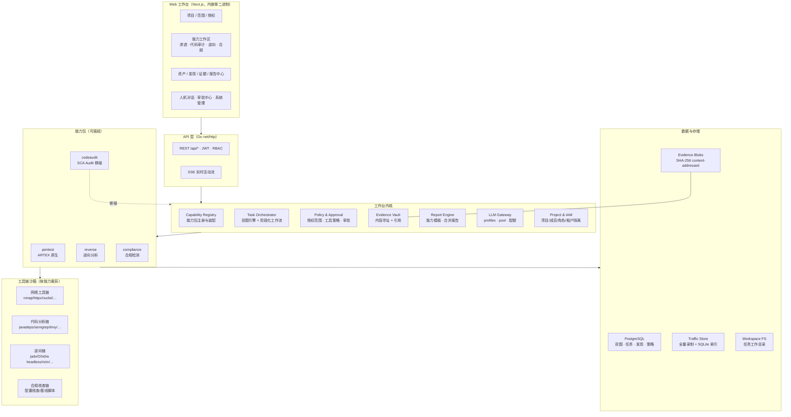
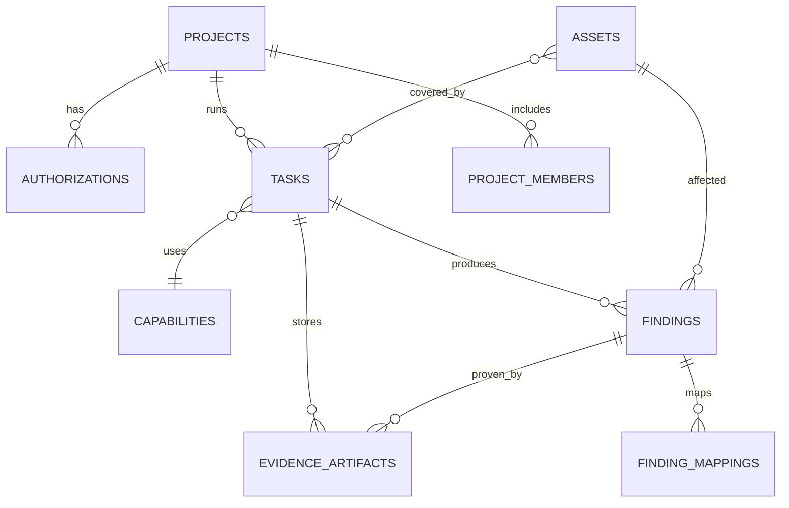

# 04 · 工作台总体架构方案

> 目标：在 ARTEX 的单体架构上，把「自主渗透」扩展为同时承载 **渗透测试 / 代码审计 / 逆向分析 / 合规检测** 四类能力的安全工作台（Security Workbench）。本文只讨论**平台层**改造：能力可插拔的装配机制、统一的数据/证据/审批模型、鉴权与隔离、迁移路径。四类能力各自的工作流与工具选型见 [03-capability-design.md](03-capability-design.md)。

## 1. 设计目标与原则

| # | 原则 | 说明 |
|---|------|------|
| P1 | **能力插件化** | 一类能力 = 一个「能力包（Capability Pack）」：agent 配置 + 工具面 + 技能包 + 工作流阶段 + 数据扩展 + UI 视图 + 报告模板。内核不写死任何一类安全能力。 |
| P2 | **保留双图与自主编排** | ARTEX 的资产图/探索图、planner-worker 闭环、事件驱动与共享 todolist 是核心资产，不改其语义，只在外面加「能力域」维度。 |
| P3 | **证据优先、可复现** | 每一条结论必须能回放到证据（源码片段、反编译产物、二进制哈希、流量、配置快照、命令输出）。沿用现有内容寻址证据仓，并扩展到代码/二进制/合规域。 |
| P4 | **授权边界显式化** | 工作台同时服务授权渗透与只读审计，必须把「客户授权 / 测试范围 / 时间窗 / 允许动作」建模成第一等对象，而不是靠提示词。 |
| P5 | **人在环路 + 最小破坏** | 所有破坏性、外发、写源码动作默认 `ask`；不同能力使用不同的工具面（如代码审计物理移除 Bash/网络工具）。 |
| P6 | **向后兼容、幂等迁移** | 保留 ARTEX 现有渗透任务路径；数据库沿用 `db/schema.sql` 每次启动幂等重跑的方式（README:151），只做增量 DDL + 默认值回填。 |
| P7 | **开源合规** | ARTEX 为 AGPL-3.0 且附带使用限制；修改后对外提供服务也须公开源码，工作台不得闭源分发。 |

## 2. 可复用的现有骨架（源码事实）

| 现有能力 | 代码位置 | 工作台复用方式 |
|---|---|---|
| 任务编排（planner/worker 生命周期、暂停/恢复/删除、并发准入） | `server/engine.go`、`server/manager.go`、`server/scheduler.go` | 内核保持通用，只增加 `capability` 维度与阶段化工作流 |
| Agent 运行时（goals/planner/worker/mainagent） | `agent/*.go`、`norma/` | 新增「能力专用 agent profile」（DB 行 + 提示词），不改运行时 |
| Agent 配置化（名称/角色/提示词/预算/skill/MCP 可见性） | `db/schema.sql` 的 `agents`、`agent_prompts`、`agent_prompt_vars`、`agent_visibility`、`agent_skill_visibility` | 直接复用；角色枚举需扩展（见 §4.4） |
| 内置工具目录 + DB 覆盖 | `agent/toolcatalog.go:10-17`、`db/schema.sql:935`（`tools` 表） | 作为「工具面」治理基础：按能力绑定/裁剪工具 |
| 技能包 | `skills/`、`skill_usage`、`agent_skill_visibility` | 每类能力一个技能目录（如 `skills/codeaudit-*`、`skills/reverse-*`） |
| MCP 接入 | `mcphttp/`、`mcp_servers`、`system/mcp` 页面 | 逆向/合规可接外部工具型 MCP；按能力限制可见性 |
| 工具调用拦截与人工审批 | `intercept/intercept.go:1-12`（allow/deny/ask + 超时）、`guard/guard.go`、`intercept_pending` | 升级为「能力策略 + 授权范围」双层策略引擎 |
| 流量录制（MITM 代理） | `traffic/traffic.go`（go-mitmproxy，全量明文留痕）、`finding_traffic_bindings` | 渗透/合规网络证据复用；代码/逆向能力默认禁用 |
| 内容寻址证据仓 | `evidence/store.go`（SHA-256 blob，独立于流量） | 扩展 artifact 类型（源码包、反编译产物、二进制样本、配置快照） |
| 双图资产模型 | `db/schema.sql` 的 `companies/assets/company_scope` 与 `explorations/exploration_nodes/exploration_edges/exploration_anchors` | 增加「资产域」维度，代码/二进制/合规对象都挂同一张图 |
| 发现与复测 | `findings`、`finding_retests`、`finding_workflow`、`server/finding_retests.go` | 统一 finding schema，增加 CWE/CVE/等保条款映射与三态复核 |
| 报告 | `report/report.go`、`report/findings.go`（Markdown/CSV）、任务归档包 `server/task_archive_package.go` | 增加按能力/甲方的报告模板与合规报告渲染 |
| Web 前端 IA | `web/src/navigation/sidebar/sidebar-items.ts:64`、`web/src/app/(main)/**` | 新增「项目 / 能力入口 / 合规中心 / 报告中心」导航与页面 |
| 单二进制/部署/升级 | `go:embed` 前端、`Dockerfile`、`build.sh`、`selfupdate/` | 工具链容器镜像与能力包一起分发；离线/内网部署沿用 Docker Compose |
| 鉴权 | `server/auth.go:140,208`：仅「管理员密码」单账号 JWT | **缺口**：多用户/多角色需从 CodeScan-Artex 移植（`users.go/authz.go/policy.go`） |

> 关键缺口：`guard/guard.go:4` 明确写着「RoE authorization-scope mechanism was removed; a replacement may be added later」——**授权范围机制当前不存在**，这是工作台化之前必须补上的第一块地基（见 §4.5）。

## 3. 目标架构



**分层职责**

| 层 | 职责 | 与现状的关系 |
|---|---|---|
| Web 工作台 | 项目上下文、能力工作区、审批、报告 | 在现有 Next.js IA 上增量扩展 |
| API 层 | 统一 REST + SSE、RBAC | 现有 `Handler()`（`server/server.go:650`）继续扩展路由组 |
| 工作台内核 | 能力注册、编排、策略、证据、报告、LLM、IAM | 新增包（建议 `capability/`、`project/`、`policy/`），编排复用 `server/engine.go` |
| 能力包 | 每类能力的装配清单与业务逻辑 | 新增目录（建议 `capabilities/{pentest,codeaudit,reverse,compliance}/`） |
| 数据与存储 | 关系库 + 证据 blob + 流量 + 工作目录 | 复用并扩展 schema |
| 工具链沙箱 | 实际执行工具 | 现有容器镜像扩展为多分析镜像（按能力挂载） |

## 4. 六个核心机制

### 4.1 能力包（Capability Pack）

一个能力包是一个**声明式装配单元**，建议结构：

```text
capabilities/<name>/
  capability.yaml        # 元数据：id/名称/输入类型/默认策略/报告模板/依赖工具
  agents.yaml            # 能力专用 agent profile（key/role/prompt/预算/工具面）
  tools.go               # 能力领域工具（注册进 tools 表 catalog）
  workflow.go            # 阶段定义与阶段完成判据
  policy.yaml            # 工具允许面/禁止面、审批规则、网络与写权限
  reports/               # 报告模板（渗透报告/审计报告/逆向报告/合规报告）
```

运行时：`capability.Registry` 在启动时读取 `capabilities` 表（DB 行为准，代码包为默认值），在**创建任务时**绑定能力，装配 ① agent profile ② 工具面 ③ 技能包 ④ 工作流 ⑤ 报告模板。

DB 建议新增：

```sql
CREATE TABLE IF NOT EXISTS capabilities (
    id          BIGSERIAL PRIMARY KEY,
    key         TEXT NOT NULL UNIQUE,      -- pentest / codeaudit / reverse / compliance
    name        TEXT NOT NULL,
    description TEXT NOT NULL DEFAULT '',
    version     TEXT NOT NULL DEFAULT '1',
    enabled     BOOLEAN NOT NULL DEFAULT true,
    config      JSONB NOT NULL DEFAULT '{}' -- 工具面/阶段/默认策略/报告模板
);
-- tasks 增加 capability_id 与 workflow_state
ALTER TABLE tasks ADD COLUMN IF NOT EXISTS capability_id BIGINT REFERENCES capabilities(id);
ALTER TABLE tasks ADD COLUMN IF NOT EXISTS workflow_state JSONB NOT NULL DEFAULT '{}';
```

> 复用点：`task_categories`（分类）与 `task_templates`（预设目标/拦截规则快照）已经存在，可把「模板」升级为「能力包实例化入口」，避免另起一套。

### 4.2 能力化任务编排

- **任务创建**：`(project, capability, target/scope, 授权记录)` → 生成任务 + 探索图 + 初始资产。
- **阶段化工作流**：渗透保持现有 planner 自由编排；代码审计/合规采用「阶段 + 判据」（如 采集→索引→分片审计→复核→报告），由能力包声明，内核只负责调度与状态机。
- **完成判据**：能力包提供 `done_criteria`（渗透=目标证明；代码审计=覆盖清单+复核通过；逆向=关键函数/行为结论；合规=条款核查覆盖率），避免通用 `goal_met` 被误用。
- **跨任务编排**：复用 `agent_triggers`（scheduler 已在 `server/scheduler.go` 实现 interval/findings/goals/task_create/tool_call 触发），支持「渗透发现→代码审计复核」「审计发现→合规条款」的联动。

### 4.3 工具面治理（Tool Surface）

现状：内置工具集是代码层（`agent/toolcatalog.go`），DB `tools` 表只覆盖描述/schema/默认绑定，不改变 handler。工作台需要**按能力裁剪可调用面**：

1. **允许面（allowlist）**：能力包声明本能力可用工具（如 codeaudit 仅 `Read/Write/Edit/MultiEdit/LS/Glob/Grep` + 领域工具，**物理移除 Bash/网络/MCP**）。可直接借鉴 CodeScan-Artex 的三层防线：只构造 7 个本地文件工具、装配层不注入危险来源、`codeAuditDeniedTools` 黑名单兜底（见 02 文档）。
2. **禁止面（denylist）**：即使 DB/可见性配置被改，也在装配最后一步按名字剔除（工具名匹配 + `mcp__*`/`traffic_*` 通配）。
3. **执行面**：Bash/命令执行按能力路由到不同沙箱（网络靶场容器 / 只读代码沙箱 / 逆向分析容器），而非同一容器。
4. **国策层**：`intercept_rules` 作为第二层兜底（如「源码只读」「不出网」「外部写入需审批」），并按能力各自 seed 默认规则。

建议新增 `tool_profiles`（能力 → 工具允许/禁止面、沙箱类型、网络策略），任务运行时解析。

### 4.4 Agent 与角色

- 现有 `agents` 表角色约束：`CHECK (role IN ('goals','main','planner','worker','assistant'))`（`db/schema.sql:789`）。新能力域**不应**硬加枚举；建议：
  - 内核角色（goals/main/planner/worker）保持不变；
  - 能力专用 agent 统一使用 `assistant` 或新增 `capability` 角色（DDL 需重建约束，建议加 `capability` 并保留旧值）；
  - 能力内角色（如 codeaudit-planner / codeaudit-worker / reviewer）用 `agent key + capability_id` 表达，提示词走 `agent_prompts`。
- 代码审计的「复核 agent」可复用现有复测机制（`finding_retests` 的三态结论：仍可复现/已修复/无法确认）改造为「复核结论」。

### 4.5 授权、范围与审批（工作台的地基）

`guard/guard.go:4` 已说明 RoE（Rules of Engagement）机制被移除，当前只剩审计日志 + 通用拦截规则，**不足以支撑对外提供安全测试服务**。建议新增：

```sql
CREATE TABLE IF NOT EXISTS authorizations (          -- 一次授权（Engagement / RoE）
    id            BIGSERIAL PRIMARY KEY,
    project_id    BIGINT NOT NULL REFERENCES projects(id),
    client        TEXT NOT NULL,
    scope         JSONB NOT NULL,                    -- 域名/IP/CIDR/仓库/样本/系统名单
    actions       JSONB NOT NULL,                    -- 允许动作：scan/exploit/read-only…
    window_start  TIMESTAMPTZ,
    window_end    TIMESTAMPTZ,
    proof_ref     TEXT,                              -- 授权书/邮件/合同在证据仓的引用
    status        TEXT NOT NULL DEFAULT 'draft',     -- draft/active/expired/revoked
    created_by    BIGINT, created_at TIMESTAMPTZ NOT NULL DEFAULT now()
);
CREATE TABLE IF NOT EXISTS project_members (
    project_id BIGINT NOT NULL, user_id BIGINT NOT NULL,
    role TEXT NOT NULL,                              -- owner/operator/auditor/viewer
    PRIMARY KEY (project_id, user_id)
);
```

强制点（缺一不可）：

1. **任务创建前**：目标必须落在 active 授权的 scope 内；代码审计必须证明仓库归属/授权；逆向样本必须声明合法来源。
2. **工具调用前**：`guard.preToolUse` 加入授权范围检查（域名/IP/路径/样本哈希），越界即 `deny`；破坏性动作（写源码、删数据、外发）转 `ask`。
3. **运行中**：时间窗越界自动暂停；范围变更需重新审批。
4. **全过程**：`activity` + `guard.Audit()` + `server_logs` + 证据引用形成不可抵赖的操作链。

### 4.6 用户、项目与租户隔离

- ARTEX 现状是**单管理员**（`server/auth.go` 仅有管理员密码初始化/修改，schema 无 `users` 表）。
- CodeScan-Artex 已实现多账号与部门可见性（`db/users.go`、`server/users_api.go`、`server/authz.go`、`server/policy.go`、前端 `admin-only.tsx`），可作为移植来源；建议直接引入「用户 + 角色 + 项目成员」模型，而不是把整个二开分支合并进来。
- 隔离维度：项目（project）→ 资产/任务/发现/证据/报告；角色：owner（项目管理员）/ operator（执行）/ auditor（只读+复核）/ viewer。LLM 配置可全局或按项目（`llm_profiles` 已有按任务绑定能力）。

## 5. 统一数据模型演进



| 演进项 | 现状 | 建议 |
|---|---|---|
| 项目容器 | 无（仅有 `task_categories` 分类） | 新增 `projects`（客户/项目/环境/时区/报告抬头） |
| 资产域 | `assets.type` 只有 `root_domain/ip/subdomain/app/service/endpoint`（`db/schema.sql:43`） | 新增 `asset_domain`（network/code/binary/compliance）与扩展类型（repo/file/function/dependency/binary/symbol/control）；用增量 `ALTER ... DROP CONSTRAINT / ADD CONSTRAINT` 或新增列兼容旧值 |
| 发现模型 | `findings`（vulnclass/severity/summary/evidence/report/status） | 增加 `finding_domain`、`cwe`、`cve`、`control_refs JSONB`（等保条款/密评指标）、`confidence`、`review_state` |
| 证据模型 | `evidence` 内容寻址 + `traffic_evidence_snapshots` | 增加 artifact 类型与元数据：源码包/反编译工程/二进制样本/反汇编片段/配置快照/合规截图；统一 `evidence_artifacts(id, task_id, kind, sha256, bytes, meta)` 引用 |
| 报告模型 | Markdown/CSV 导出、任务归档包 | 新增 `report_templates`（能力/客户/标准）与「项目合并报告」生成器 |
| 工具面 | `tools` 表（描述/schema/绑定） | 新增 `tool_profiles`（能力→允许面/沙箱/网络策略） |

> 迁移原则：所有新表 `CREATE TABLE IF NOT EXISTS`，新列 `ADD COLUMN IF NOT EXISTS` + 默认值回填；旧任务默认 `capability_id = pentest`，不改变现有行为。

## 6. API 与前端 IA

**API 增量（示例，保持现有 `/api/*` 风格）**

| 路由组 | 用途 |
|---|---|
| `/api/projects`, `/api/projects/{id}/members` | 项目与成员 |
| `/api/authorizations`, `/api/authorizations/{id}/approve` | 授权/范围/时间窗 |
| `/api/capabilities` | 能力包列表与配置 |
| `/api/tasks`（增加 `capability_id`、`project_id`） | 按能力建任务 |
| `/api/codeaudit/projects`, `/api/codeaudit/uploads` | 代码审计入口（复用 CodeScan 的 task_uploads） |
| `/api/reverse/samples`, `/api/reverse/functions` | 逆向样本与函数视图 |
| `/api/compliance/assessments`, `/api/compliance/controls` | 合规评估与条款核查 |
| `/api/reports`, `/api/reports/export` | 报告中心 |
| `/api/policy/rules`, `/api/intercept/pending` | 策略与审批（已有拦截审批可扩展） |

**前端 IA（在 `web/src/navigation/sidebar/sidebar-items.ts` 增量）**

```text
功能
├── 工作台首页（项目卡片 + 能力状态 + 风险概览）
├── 项目（新建项目 → 授权 → 选能力 → 任务）
├── 渗透测试   ← 现有任务/资产/流量/发现 视图（按能力过滤）
├── 代码审计   ← 审计工程 / 覆盖清单 / 依赖与反编译 / 复核
├── 逆向分析   ← 样本 / 函数与调用图 / 行为与字符串 / 报告
├── 合规检测   ← 标准选择 / 条款核查 / 证据 / 报告
├── 资产       ← 统一资产图（按域切换）
├── 发现       ← 统一发现列表（含 CWE/CVE/条款映射）
├── 证据       ← 统一证据仓浏览
├── 报告中心
└── 系统管理（agent/工具/skill/MCP/LLM/拦截/日志/用户）
```

现有页面（`web/src/app/(main)/**`）大部分可复用：任务详情增加「能力专属 tab」，资产/发现/证据页增加「域」过滤即可。

## 7. 安全与合规控制矩阵

| 控制项 | 渗透测试 | 代码审计 | 逆向分析 | 合规检测 |
|---|---|---|---|---|
| 授权/范围强制 | 必须（域名/IP/CIDR + 时间窗） | 必须（仓库归属） | 必须（样本合法来源） | 必须（被检系统授权） |
| 网络出网 | 仅目标范围 | **禁止** | **禁止**（除非样本外联分析，需审批） | 仅被检系统 |
| 命令执行 | 沙箱内 Bash | 物理移除 Bash | 分析容器内只读 | 只读核查脚本 |
| 源码/样本写保护 | 不涉及 | 源码只读 | 样本只读 + 哈希 | 配置只读 |
| 破坏性动作 | `ask` | 不适用 | `ask` | 不适用 |
| 证据完整性 | 流量快照 + 哈希 | 代码片段 + 行号 | 二进制 SHA-256 + 产物 | 配置/截图 + 哈希 |
| 审计留痕 | 工具调用 + 审批 | 同左 | 同左 | 同左 |
| 数据出境 | 客户数据不出本地（LLM 可配置本地模型） | 源码分片脱敏/本地模型 | 样本不发送第三方 | 文档脱敏 |

## 8. 兼容与迁移策略

1. **加性演进，不 fork**：能力层以新包 + 新表 + 新路由落地，现有渗透路径行为不变；默认能力 = `pentest`。
2. **选择性移植 CodeScan-Artex**：优先移植 `users/authz/policy`（多账号与权限）、`javadeps`（Java 反编译依赖）、`codeaudit_tools` 工具面与只读沙箱思路、`task_uploads/task_deps`；不整体合并其分支，避免两套 `main` 长期分叉。
3. **工具链镜像分档**：`artex`（基础） / `artex-pentest` / `artex-codeaudit` / `artex-reverse`，按能力挂载；Docker Compose profiles 选择。
4. **升级兼容**：沿用 `schema.sql` 幂等迁移 + `selfupdate`；新增能力包版本字段，能力包可独立升级。
5. **开源义务**：修改版若对外提供服务，按 AGPL-3.0 公开完整源码；对外交付物中保留许可证与免责声明。

## 9. 新增一类能力的落地清单（Checklist）

1. 定义能力包元数据（id/输入类型/阶段/完成判据/报告模板），写入 `capabilities` 默认行。
2. 新增 agent profile 与提示词（`agents` + `agent_prompts` + 变量目录），跑通最小闭环。
3. 定义工具面：领域工具注册进 `agent/toolcatalog.go` 的 seed + `tools` 表；`tool_profiles` 声明允许/禁止面与沙箱。
4. 提供技能包（`skills/<capability>-*/SKILL.md`）与可见性绑定。
5. 扩展 DB：资产域/发现映射/证据 artifact；全部幂等 DDL + 回填。
6. 增加 server 路由组（建任务、上传、查询、导出），复用 `requireAuth` 与 SSE。
7. 增加前端页面：能力工作区、详情 tab、报告视图；导航项按能力开关。
8. 增加策略规则：默认拦截规则 seed（如源码只读、不出网）+ 授权范围检查。
9. 增加报告模板与验收测试（`go test ./...`、前端 `npm run build:static`、E2E 冒烟）。

## 10. 非功能性要求

| 维度 | 要求 |
|---|---|
| 并发 | 复用 `scheduler` 并发准入与 `tasks.queued`；能力任务按资源配额（CPU/内存/LLM 并发）分池 |
| 存储 | 流量与证据是主要增长项：沿用现有归档/回收机制（`traffic` 归档、`task_archives`）；代码/二进制产物走证据仓 + 生命周期策略 |
| 成本 | 复用 `llmpool`/`llm_profiles`/预算字段；按能力设 token 预算与 per-task 上限 |
| 可观测 | 复用 `server_logs`、`llm_records/llm_usage`、`activity`、拦截审计；新增能力维度指标 |
| 安全 | JWT + RBAC + 项目 ACL + 授权范围；镜像最小权限；密钥/凭据按项目隔离 |
| 部署 | 单二进制 + Docker Compose；内网/离线场景支持本地模型与离线工具链 |
| 升级 | `selfupdate` + 幂等 schema；能力包独立版本，向后兼容旧任务 |

## 11. 待决问题

1. **产品形态**：对外 SaaS 多租户 vs 内部单团队工作台？决定 IAM/隔离投入（本方案按「项目级隔离」设计，可先单租户）。
2. **上游同步**：ARTEX 上游已停止维护（本仓库为最后版本备份），`norma` 上游闭源改为本仓库 vendored；工作台是否长期维护 fork、是否回馈上游需明确。
3. **合规边界**：合规检测只做技术辅助（配置核查/证据采集），不提供法律意见；对外报告需法务审核模板。
4. **代码审计深度**：是否引入 CodeQL（商业许可限制）/ Joern（Apache-2.0）等重型引擎，与 LLM 分片审计如何分工，需在 P1 验证。
5. **逆向合规**：样本来源合法性、软件许可（如闭源商业软件逆向）边界需产品与法务共同确认。
