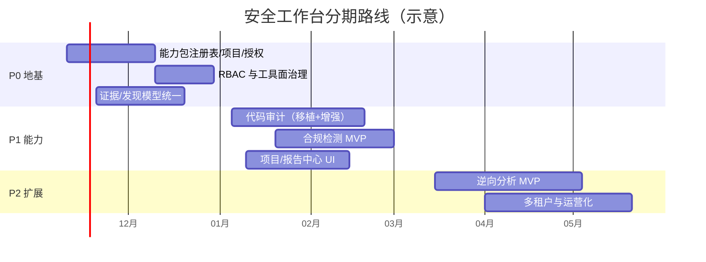

# 05 · 落地路线图与风险登记

> 本文给出在 ARTEX 代码库上演进为安全工作台的分期计划、验收标准与风险登记。工作量估算以 **2–3 名全栈工程师（Go + Next.js）全职** 为参照；实际排期需结合团队与目标市场调整。能力细节见 [03-capability-design.md](03-capability-design.md)，平台改造见 [04-workbench-architecture.md](04-workbench-architecture.md)。

## 0. 开工前的四个决策

| # | 决策 | 选项 | 影响 |
|---|---|---|---|
| D1 | 产品形态 | A. 内部单团队工作台；B. 对外多租户 SaaS | B 需要在 P0 就投入租户隔离/计费/数据合规 |
| D2 | 上游策略 | A. 长期维护本仓库 fork；B. 仅作为起点、后续独立演进 | 决定与 ARTEX 上游/CodeScan 分支的同步成本 |
| D3 | 合规边界 | 技术辅助（配置核查/证据采集/整改建议）vs 出具合规结论 | 只有前者可由平台自动产出；后者需具备资质的机构签署 |
| D4 | LLM 策略 | 云端 API / 自建/本地模型 / 混合 | 决定源码与样本数据出境策略、成本与部署形态 |

## 1. 分期总览

| 阶段 | 周期（示意） | 目标 | 验收出口 |
|---|---|---|---|
| **P0 地基** | 0–6 周 | 从「单能力渗透工具」变成「可承载多能力的平台」：能力注册、项目/授权、RBAC、工具面、统一资产/证据/发现 | 新能力可零改内核接入（用一个 demo 能力验证）；越界目标被拒绝；两条能力任务并存互不干扰 |
| **P1 能力落地** | 6–14 周 | 代码审计与合规检测可用：移植 CodeScan 的 read-only 审计 + javadeps，接入 Semgrep/Trivy 等；等保核查清单 + 证据 + 报告 | 对一个真实仓库产出可复核审计报告；对一套演示系统产出等保技术项核查报告；误报/漏报抽检达标 |
| **P2 扩展与运营化** | 14–26 周 | 逆向分析 MVP、统一报告中心、多租户/计费（若 D1=B）、能力生态（MCP/自定义工具） | 逆向样本分析闭环（APK/ELF）；项目报告一键导出；租户隔离测试通过 |
| **P3 持续演进** | 26 周+ | 攻击链自动化增强、Fuzzing/固件分析、更多合规标准（密评、GDPR、PCI-DSS）、能力市场 | 按业务目标定义 |

## 2. P0 地基（0–6 周）工作分解

| ID | 任务 | 产出 | 验收 |
|---|---|---|---|
| P0-1 | 能力包注册表 | `capabilities` 表 + `capability/` 包 + 启动装配；`tasks.capability_id` | 用 demo 能力（如 `codeaudit-lite`）证明「零改内核新增能力」 |
| P0-2 | 项目容器 | `projects`/`project_members` 表；任务/资产/发现/证据挂项目 | 项目隔离查询正确；旧数据自动归入默认项目 |
| P0-3 | 授权范围（RoE） | `authorizations` 表 + 创建前置校验 + `guard.preToolUse` 范围判定 | 越界目标/超时窗任务被 `deny`/暂停；审批链可追溯 |
| P0-4 | 用户与 RBAC | 移植 CodeScan `users/authz/policy`，角色 owner/operator/auditor/viewer | 未授权角色无法执行/导出；审计日志完整 |
| P0-5 | 工具面治理 | `tool_profiles` + 装配裁剪 + 黑名单兜底 + 按能力沙箱路由 | 代码审计能力下 Bash/网络/MCP 工具物理不可见；DB 篡改也无法绕过 |
| P0-6 | 统一模型 | 资产域、finding 映射（CWE/CVE/条款）、evidence_artifacts、report_templates | 四类能力数据都能落在统一图表；旧 API 兼容 |
| P0-7 | 工作台首页/导航 | 项目卡片、能力入口、风险概览、审批待办 | 可用性评审通过；现有渗透流程零回归 |
| P0-8 | 回归保障 | `go test ./...`、前端 `npm run build:static`、关键路径 E2E | CI 全绿；旧任务行为不变 |

**P0 关键风险**：授权范围与工具面是「安全底座」，必须先于任何对外能力实现，避免「先跑起来再补边界」。

## 3. P1 能力落地（6–14 周）

### 3.1 代码审计

1. 移植 CodeScan-Artex：`users/authz`（若 P0 未完成）、`task_uploads`、`task_deps`、`javadeps`（本地 Java 反编译依赖）、`codeaudit_tools` 只读工具面、`finding_packet` 复核。
2. 接入 OSS 扫描器作为「候选发现源」：Semgrep（规则）、Trivy（依赖/容器）、Gitleaks（密钥）；CodeQL 需评估许可（商业限制），Joern 作为数据流补充（Apache-2.0）。
3. LLM 分片审计：按目录/接口切分意图，强制「文件:行号 + 代码片段」证据；独立复核会话三态回写。
4. 产出：覆盖清单、接口权限清单、依赖可达性、缺陷报告（含复现与修复建议）。
5. 验收：对 3 个真实仓库（含 1 个 Java 多模块）完成审计；缺陷抽检准确率 ≥ 80%（人工标注 30 条样本）；误报可一键复核。

### 3.2 合规检测

1. 标准库：等保2.0（GB/T 22239-2019）技术/管理要求条款化，密评（GB/T 39786-2021）指标化；条款 = 可核查检查项（命令/配置/截图/访谈）。
2. 采集器：只读配置核查脚本（Linux/Windows/数据库/中间件/网络设备）、资产台账、日志与访问控制核查。
3. Agent：合规评估 agent 按条款生成核查计划 → 执行采集 → 证据绑定 → 差距分析 → 整改建议。
4. 产出：条款覆盖率、符合/部分符合/不符合、证据引用、整改清单、报告。
5. 验收：演示环境 + 1 个真实测试环境完成技术项核查；报告可由测评机构直接引用（法务/测评顾问复核）。

### 3.3 平台能力

- 报告中心：项目级合并报告（渗透 + 审计 + 合规），模板可配置。
- 审批中心：统一 `intercept_pending` + 授权变更审批。
- 质量门禁：能力任务必须绑定授权与项目才能创建。

## 4. P2 扩展（14–26 周）

| 方向 | 内容 | 关键风险 |
|---|---|---|
| 逆向分析 | 样本管理（APK/ELF/PE/固件）、jadx/apktool 反编译、Ghidra headless/rizin 反汇编、字符串与符号、行为与网络指标、CVE/组件指纹；只读分析沙箱 | 工具链复杂、样本合法性、性能与存储 |
| 移动安全 | APK/IPA 静态 + 动态（Frida）分析、证书/加固识别 | 设备/模拟器资源、动态分析隔离 |
| 运营化 | 多租户、配额/计费、SLA、审计导出、私有化部署包 | 隔离缺陷会导致数据泄露 |
| 能力生态 | 能力包 SDK、MCP 工具市场、自定义检查项 | 质量与安全审核 |

## 5. 质量与验证策略

- **单元/集成**：Go 侧沿用表驱动测试风格（现有 `*_test.go` 覆盖 engine/store/intercept 等），新增能力包必须有装配测试与策略测试（越权/越界用例）。
- **前端**：`npm run check`（Biome）+ `npm run build:static`；关键页面 Playwright 冒烟（仓库已带 `skills/playwright-cli`）。
- **安全测试**：授权越界、工具面绕过（DB 篡改）、路径穿越（复用 `wsResolve` 思路）、租户隔离、证据篡改检测。
- **评测集**：为代码审计/逆向建立带标注的基准样本（如 OWASP Benchmark、Juliet、自建靶场），持续度量准确率与成本。
- **回归**：P0 起冻结「渗透任务」黄金路径（建任务→跑通→出报告），每个 PR 必须保持通过。

## 6. 里程碑与出口标准

| 里程碑 | 时间（示意） | 出口标准（可验收） |
|---|---|---|
| M1 平台地基 | 第 6 周 | 项目/授权/RBAC/工具面可用；新能力零改内核接入；旧渗透流程全绿 |
| M2 代码审计 MVP | 第 11 周 | 真实仓库审计报告可交付；复核三态闭环；工具面只读不可绕过 |
| M3 合规 MVP | 第 14 周 | 等保技术项核查 + 证据 + 报告；条款覆盖率 ≥ 90% |
| M4 逆向 MVP | 第 20 周 | APK/ELF 样本分析闭环 + 报告；沙箱无出网 |
| M5 产品化 | 第 26 周 | 多租户/配额/审计导出/部署包（按 D1 决定是否必需） |

## 7. 风险登记册

| ID | 风险 | 概率 | 影响 | 缓解措施 |
|---|---|---|---|---|
| R1 | **AGPL-3.0 传染性**：基于 ARTEX 修改后对外提供服务须公开源码 | 高 | 高 | 明确开源策略；对外服务即开源；与法务确认分发边界 |
| R2 | **上游使用限制**：ARTEX 声明「仅供本地隔离环境验证，禁止对线上系统实际测试」 | 高 | 高 | 工作台必须内置授权范围/授权书管理；对外交付时重写使用条款与免责声明；仅服务合法授权场景 |
| R3 | **norma 依赖风险**：上游闭源、本仓库 vendored；CodeScan 未 vendored | 中 | 高 | 锁定 `./norma` 版本；长期评估自研 agent 内核或 fork 维护；构建离线化 |
| R4 | **授权/范围机制缺失**：`guard` 的 RoE 已被移除 | 高 | 高 | P0 必做；未完成前不对外提供渗透服务 |
| R5 | **双分支分叉**：CodeScan-Artex 与 ARTEX 各自演进，合并成本上升 | 高 | 中 | 只移植能力、不合并分支；建立共享库/上游补丁流程 |
| R6 | **LLM 幻觉与误报**：安全结论可信度 | 高 | 中 | 证据强制（命令输出/代码片段/流量）、独立复核、人工抽检 |
| R7 | **成本失控**：多能力 × 多 agent × 长任务 | 中 | 中 | 预算/配额/并发池、缓存与增量、按能力分层模型 |
| R8 | **数据安全**：源码/样本/客户数据发送第三方 LLM | 中 | 高 | 本地模型选项、脱敏、项目级密钥与 DLP |
| R9 | **工具许可**：CodeQL/商业逆向工具许可限制 | 中 | 中 | 优先 Apache/MIT/LGPL 工具；商业工具仅本地部署 |
| R10 | **样本/逆向合法性** | 中 | 高 | 样本来源声明与审批；禁止绕过 DRM 等高风险场景 |
| R11 | **合规报告责任**：技术核查 ≠ 合规结论 | 中 | 高 | 报告明确「技术辅助」；需资质机构复核签署 |
| R12 | **性能与存储**：流量/证据/反编译产物增长快 | 中 | 中 | 归档与生命周期策略、增量索引、对象存储可选 |

## 8. 运营与合规事项

1. **许可证**：保留 AGPL-3.0 LICENSE 与免责声明；修改版对外提供服务时公开完整源码。
2. **授权管理**：每个项目必须上传/登记授权证明；任务创建时强制校验 scope 与时间窗；撤销即时生效。
3. **数据留存**：按客户要求设定证据保留期；支持项目级导出与销毁；敏感流量默认不脱敏，需按项目开启脱敏（现状 `traffic` 为全量明文，见 `traffic/traffic.go` 注释）。
4. **审计**：所有工具调用、审批、导出、登录写审计日志，支持按项目导出。
5. **安全事件响应**：越界告警、任务急停（现有 `StopTask`/`kill_work` 可复用）、证据封存。

## 9. 建议的下一步（2 周内可执行的 spike）

1. 搭 P0 骨架：`capabilities`/`projects`/`authorizations` 三张表 + 建任务校验 + 一个只读 demo 能力。
2. 移植 CodeScan 的 `users/authz/policy` 与 `codeaudit_tools` 到 ARTEX 分支，跑通「只读代码审计」最小闭环。
3. 准备一个演示项目：授权范围 → 渗透任务 → 代码审计任务 → 合并报告，作为工作台 Demo。
4. 用 3 个真实仓库 + 1 套演示系统做能力验证，收集误报/成本数据，据此校准 P1 范围。
